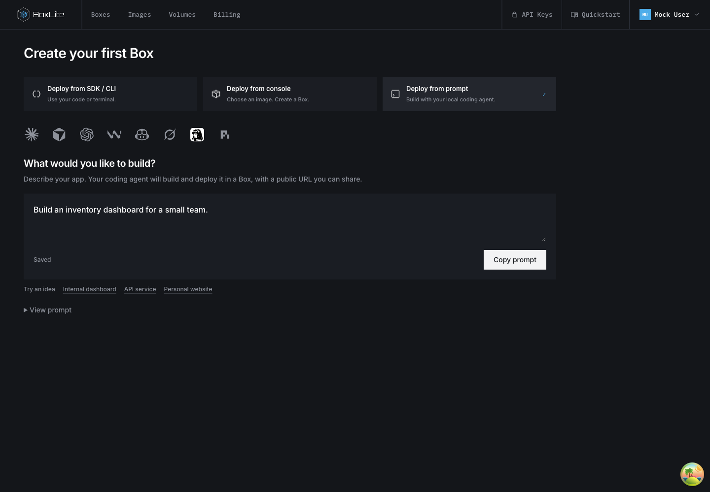
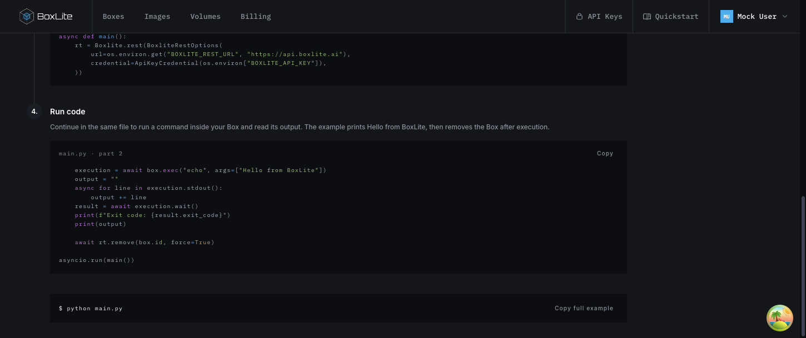
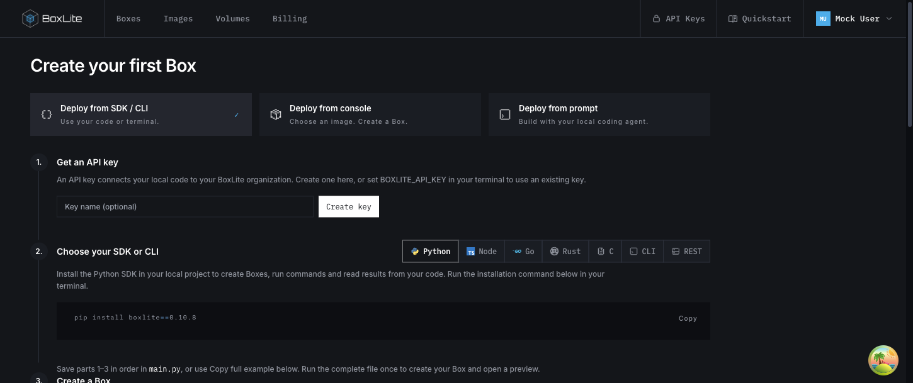
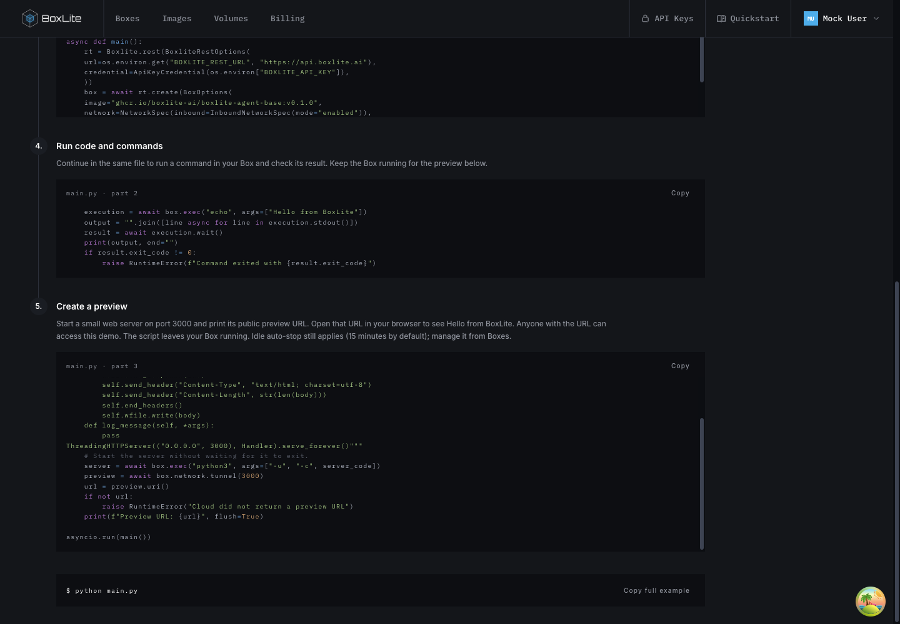

# New-user onboarding

## Design

New accounts should name their organization, state their use case, and reach one
Quickstart page with SDK/CLI, public image templates, and local-agent prompt paths.
Answers and prompt drafts belong to the backend; credit delivery is confirmed independently.

Scope: welcome, Quickstart, image templates, terminal auto-connect and persistence.
Keep the existing empty Boxes page and main's network/authentication behavior. Exclude
Billing restyling, Apps prototypes, first-run simulation, and fake terminal output.

Related work: the existing OrganizationController name endpoint owns organization updates;
OrganizationActionGuard owns membership/owner checks. Reuse both. The signup-credit pending
query on main uses bounded backoff against coupon/register; reuse the delivery contract,
not a timer as proof. Existing Quickstart examples own SDK execution; render their actual
programs in steps instead of maintaining separate snippets. Existing handoff credentials
remain in client memory, while only user-authored request text is persisted.

Use a dedicated page rather than retaining two competing modal/page onboarding flows.
Draft revisions prevent out-of-order autosaves; request IDs deduplicate handoff snapshots.
A copied prompt is not evidence of successful deployment. Existing organizations without
answers are not globally redirected; only the existing first-run entry invokes welcome.

Validation: type checks, targeted component/API tests, real PostgreSQL migration/concurrency
checks, production build and UI walkthrough. Document observed results before publication.

## User flow and deployment

1. A new account names its organization using the existing organization-name endpoint.
2. Choose a use case and optionally describe it. Continue saves this answer on the organization, then polls signup-credit delivery with bounded backoff. Failures remain visible and can be retried, or the user can explicitly continue without credits. Installations without billing finish without polling; setup completion never implies a credit grant. The browser skip flag is written only on completion, and a confirmed organization rename survives a reload before intent submission.
3. Quickstart offers SDK/CLI, console templates, or a prompt for a local coding agent. Console creation uses the selected public image, resource defaults and startup command. Existing Boxes empty-state content remains unchanged.
4. Prompt text autosaves after one second and on blur, scoped to the organization and user. Refresh restores saved text. Prepare prompt saves a handoff snapshot; the following Copy prompt click writes directly to the clipboard without waiting on network requests. Editing the request requires preparation again. A failed copy acknowledgement can be retried separately from a successful copy; credentials are added only in the browser, never persisted in the snapshot. Copied status does not mean an application was deployed.

Apply the additive API migration before releasing the dashboard. The organization use case and per-user draft endpoints must be deployed together with this UI. See [API persistence contract](../api/src/organization/ONBOARDING.md) for authorization, validation, revision conflicts and retention.

Public templates share their catalog with Images. Virtual and curated template rows are not removable from the catalog; an organization-owned image remains removable even if its reference matches a template; user-imported images retain their existing lifecycle. Public registry availability and runner architecture can change; this PR does not guarantee every future upstream tag remains available.

## UI comparison

These screenshots use local development fixtures, not a production account. The walkthrough covered organization name, long-running-agent intent, credit confirmation, switching all three methods, and saving/restoring prompt text after refresh.

Before: the existing modal combines the initial choice and agent handoff.

After: open Quickstart, choose Deploy from console, select Python, then Create Box.

After: choose Deploy from prompt, enter a request, wait for Saved, refresh, and return to the prompt path to restore it.

## Verification boundaries

Targeted dashboard tests cover routing, credit backoff, template rows, generated code steps, organization-save errors, and prompt autosave/revision behavior. API tests cover validation, authorization, idempotency and revision conflicts. Migration tests run against a disposable PostgreSQL database supplied through `ONBOARDING_TEST_DATABASE_URL` and create/drop their own schema. Frontend and API TypeScript checks and the dashboard production build passed locally.

The browser walkthrough used MSW fixtures. The integrated signup flow has not been deployed or accepted against the production API; complete that check after migration and backend deployment. Terminal auto-connect is included as a behavior change; a full-revert regression demonstration was not run for it.

The dashboard CI suite also checks the shared typography and square-corner design rules. Onboarding uses the named type-scale tokens. Interaction tests exercise name/intent submission, save retries, template creation and deployment-method switching; canvas tests cover reduced motion, viewport suspension and cleanup. Regenerate both cloud API clients whenever the onboarding DTOs or controller change, using the repository's pinned OpenAPI generator.

SDK guide state is keyed by authenticated user and organization. Switching either clears the displayed credential and isolates late key-creation responses. PostgreSQL + pgvector uses an automatically generated `POSTGRES_PASSWORD`, available in the Box environment.

### Resuming Welcome and prompt confirmation

Automatic Welcome navigation applies only to organization owners, who can save the organization name and intent. Members can still explicitly open Quickstart. A completed Welcome flow is restored from progress scoped to the current user and organization in the same browser, including completion through “Continue without credits”; restoration does not claim that credits were granted. This browser completion timestamp is not synchronized across devices.

A prompt copy confirmation and its retries stay bound to the handoff that actually reached the clipboard. Editing the request invalidates that confirmation state, so a delayed failure from an older copy cannot expose a retry for a newly prepared prompt.

### SDK Quickstart previews

The SDK/CLI path continues from running a command to serving a small HTTP page
on port 3000. Python, Node, Go, Rust, C, CLI and REST all use the same three-part
program: create a Box with inbound networking enabled, execute a command, then
start a Python HTTP server in the guest and print its public preview URL.
The URL is public and does not require the API key. The script exits without
stopping or deleting the Box; users manage their resources in Boxes. Cloud idle
auto-stop still applies (15 minutes by default), so the URL is not guaranteed
to remain available indefinitely.

Save the three displayed parts in order in the named file, or use **Copy full
example**, then run the file once. Each section and the full example come from
the same template. The server source is included in the program, so users do
not need a second file or additional guest packages. SDK install commands pin
version 0.10.8. CLI and REST discover the organization route through `/v1/me`;
these examples require curl and jq. Piped API keys bypass terminal echo controls;
an empty CLI tunnel response fails instead of printing an unusable preview URL.

Templates live in `src/lib/quickstart/templates`. Explicit step markers delimit
creation, execution and preview. Keep the Box and server running after the
local program exits. Dev acceptance tests should check the public page after
process exit, then remove only their own test resources independently.

#### Preview walkthrough screenshots

These captures use local fixtures without a real API key. Select **Deploy from
SDK / CLI**, choose a language, then scroll to **Create a preview**. Copy the
complete example and run it locally; open the printed URL in a browser.

Before, the command example deleted its Box immediately:

The updated guide preserves the language selector and introduces three code parts:

The final part prints a public URL and leaves the Box running:

Template validation rejects unknown template references and missing step sections
before returning copyable code. Boundary tests exercise both failures using the
real registry and template assets, preventing incomplete programs from reaching users.
